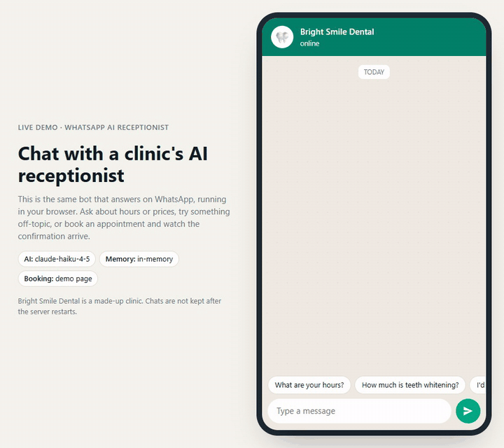
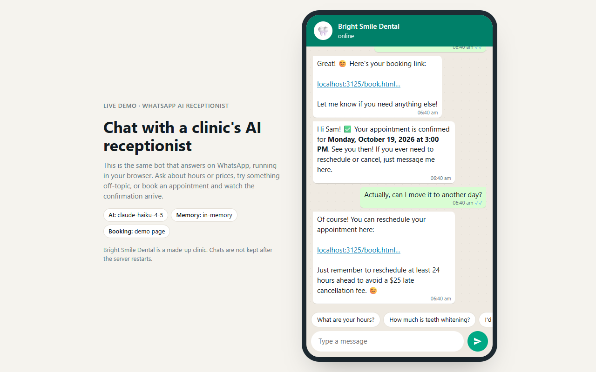
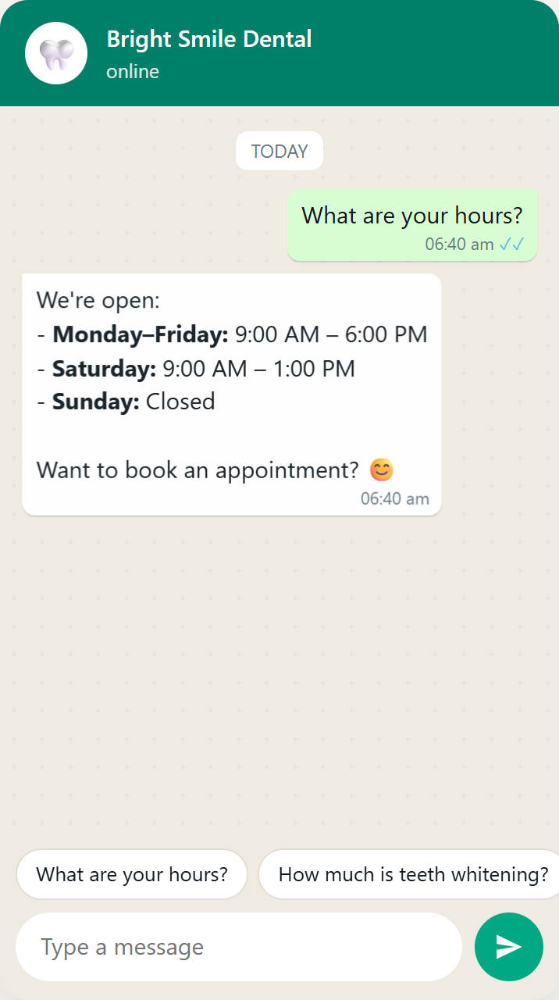
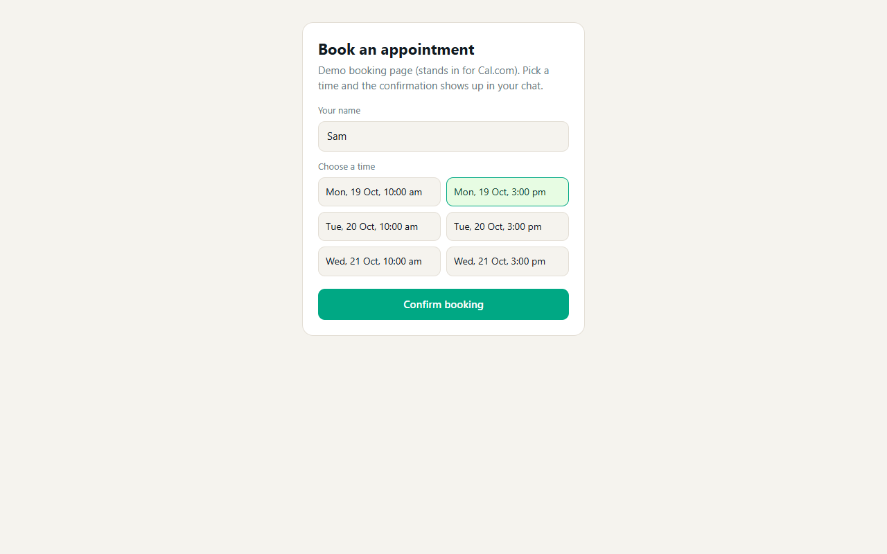

<div align="center">

# WhatsApp AI Receptionist

**An AI front desk for small clinics. It answers patients on WhatsApp from your own FAQ, books appointments, and never makes up a price.**

[](https://github.com/syedzeeshan-27/WhatsApp-AI-Receptionist/actions/workflows/test.yml)
[](LICENSE)


<!-- After deploying (see "Host a free live demo"), add: **[Live demo](https://YOUR-APP.onrender.com)** · -->
**[Quickstart](#run-it-in-2-minutes) · [Deploy your own](#deploy-your-own) · [How it works](docs/ARCHITECTURE.md)**



</div>

## What it does

A patient messages the clinic's WhatsApp number. The bot:

- **Answers questions** about hours, services, prices, location and policies, using only what's in [`knowledge/faq.md`](knowledge/faq.md). If the answer isn't there, it says so instead of guessing.
- **Books appointments** by sending your Cal.com link. When the booking comes in, it messages the patient a confirmation.
- **Handles reschedules and cancellations.** It remembers each patient's booking and hands them their own reschedule or cancel link, but only when they ask.
- **Remembers the conversation** (last 20 messages per patient), so follow-up questions make sense.
- **Stays on topic.** Ask it to write an essay and it politely declines in one line, which also keeps your API bill small.

It's built to be reused: one copy per clinic, configured with one file of facts and one file of persona settings.

The repo also ships a **browser chat simulator**, so you can try the whole thing (questions, booking, confirmation, rescheduling) without a WhatsApp number, a database, or even an API key.

## See it in action

<table>
<tr>
<td width="62%"></td>
<td width="38%"></td>
</tr>
<tr>
<td colspan="2"></td>
</tr>
</table>

### Example chats

Real replies from the recording above (Claude Haiku 4.5, the example clinic's FAQ):

> **Patient:** Hi! Are you open on Saturday?
>
> **Bot:** Hi there! 😊 Yes, we're open on *Saturdays from 9:00 AM – 1:00 PM*. Would you like to book an appointment?

> **Patient:** How much is teeth whitening?
>
> **Bot:** Teeth whitening is *$250* and takes about 1 hour in-clinic. Would you like to book? 😊

> **Patient:** Can you write my history essay for me?
>
> **Bot:** Sorry, I can only help with questions about Bright Smile Dental — our services, hours, or booking an appointment. 😊

> **Patient:** I'd like to book a check-up please
>
> **Bot:** Great! 😊 Here's your booking link: https://…/book.html?s=…

> *(patient books a slot)*
>
> **Bot:** Hi Sam! ✅ Your appointment is confirmed for *Monday, October 19, 2026 at 3:00 PM*. See you then! If you ever need to reschedule or cancel, just message me here.

> **Patient:** Actually, can I move it to another day?
>
> **Bot:** Of course! You can reschedule your appointment here: https://…/book.html?…&action=reschedule. Just remember to reschedule at least 24 hours ahead to avoid a $25 late cancellation fee. 😊

Prefer video? [demo.mp4](docs/media/demo.mp4) is the same clip in higher quality.

## Run it in 2 minutes

You need [Node.js 20+](https://nodejs.org) and git. No accounts, no keys.

```bash
git clone https://github.com/syedzeeshan-27/WhatsApp-AI-Receptionist.git
cd WhatsApp-AI-Receptionist
npm install
npm start
```

Open **http://localhost:3000** and start chatting.

With no keys the bot runs in **offline mode**: it matches keywords to sections of the FAQ, so it's not smart, but every screen works. To get the real AI, add a Claude key:

```bash
# Windows PowerShell
Copy-Item .env.example .env
# macOS / Linux
cp .env.example .env
```

Put your key from [console.anthropic.com](https://console.anthropic.com) in `.env` as `ANTHROPIC_API_KEY=...`, then restart with `npm start`. The startup log tells you which mode you're in:

```
Bright Smile Dental receptionist listening on http://localhost:3000
  AI:        claude-haiku-4-5
  Storage:   in-memory (wiped on restart)
  WhatsApp:  not configured (web chat only)
  Web chat:  http://localhost:3000/
```

Run the tests with `npm test` (offline, no keys needed).

## Keys and what they cost

Everything is optional. Add pieces as you need them.

| Piece | What it's for | Env vars | Cost |
|---|---|---|---|
| Nothing | Browser demo, offline replies, memory storage | none | Free |
| [Anthropic API](https://console.anthropic.com) | Real AI replies | `ANTHROPIC_API_KEY` | Pay per use. Haiku 4.5 is $1 / $5 per million input / output tokens, measured at about **$0.0015 per reply** here (≈1,000–1,400 tokens in, 30–90 out) |
| [WhatsApp Cloud API](https://developers.facebook.com/docs/whatsapp/cloud-api/get-started) | Real WhatsApp number | `WHATSAPP_VERIFY_TOKEN`, `WHATSAPP_ACCESS_TOKEN`, `WHATSAPP_PHONE_NUMBER_ID`, `WHATSAPP_APP_SECRET` | Free test number (up to 5 recipients). Replies to customers within 24h are free; Meta charges for some other conversation types, see [Meta pricing](https://developers.facebook.com/docs/whatsapp/pricing) |
| [Supabase](https://supabase.com) | Keep chats and bookings across restarts | `SUPABASE_URL`, `SUPABASE_SERVICE_ROLE_KEY` | Free tier is plenty |
| [Cal.com](https://cal.com) | Real booking page + confirmations | `CAL_LINK`, `CAL_WEBHOOK_SECRET` | Free plan works |
| [Render](https://render.com) | Hosting | none | Free tier (sleeps when idle) |

All settings are documented in [`.env.example`](.env.example).

## Make it your business

1. **Facts:** replace [`knowledge/faq.md`](knowledge/faq.md) with your own (start from [`knowledge/TEMPLATE.md`](knowledge/TEMPLATE.md)). The bot answers only from this file. Restart after editing.
2. **Persona:** edit [`src/config/business.js`](src/config/business.js): name, type of business, tone.
3. **Timezone:** set `TIMEZONE` in `.env` (for example `America/New_York`).

Bright Smile Dental, its address and prices are made up for the demo.

## Connect a real WhatsApp number

1. Create an app at [developers.facebook.com](https://developers.facebook.com/apps) (type **Business**) and add the **WhatsApp** product. Meta gives you a free test number.
2. From **WhatsApp → API Setup** copy the **Phone number ID** and **access token** into `.env`. Add your own phone as a test recipient.
3. From **App settings → Basic** copy the **App secret** into `WHATSAPP_APP_SECRET` so the bot can reject fake webhook calls.
4. Make your local server reachable: run `ngrok http 3000` (or deploy, below).
5. In **WhatsApp → Configuration → Webhook**, set the callback URL to `https://<your-url>/webhook`, the verify token to whatever you put in `WHATSAPP_VERIFY_TOKEN`, then subscribe to **messages**.
6. Message the test number from your phone.

The temporary access token expires after about 24 hours (error `190`). For anything real, create a **System User** token in Meta Business Settings, which doesn't expire.

## Add memory and real bookings (optional)

**Supabase:** create a free project, open **SQL Editor**, paste [`supabase/schema.sql`](supabase/schema.sql) and run it. Copy the project URL and the `service_role` key (Project Settings → API) into `.env`.

**Cal.com:** create an event type and add a **phone number** booking question (the bot needs it to message the patient). Put the public link in `CAL_LINK`. Under **Settings → Developer → Webhooks** add `https://<your-url>/webhooks/cal` with a secret (same value as `CAL_WEBHOOK_SECRET`) and the triggers *Booking created*, *Booking rescheduled*, *Booking cancelled*.

## Deploy your own

### Host a free live demo (Render)

The demo runs fine on Render's free plan. No WhatsApp or database needed.

1. Fork this repo (or use your own copy) on GitHub.
2. On [render.com](https://render.com): **New → Blueprint**, pick the repo. It reads [`render.yaml`](render.yaml).
3. When asked for `ANTHROPIC_API_KEY`, paste a key for real AI, or leave it blank for offline mode (costs nothing).
4. Click **Apply**. In a few minutes you get a URL like `https://whatsapp-ai-receptionist-xxxx.onrender.com`.

If you use a real key on a public demo, it's protected by limits: 200 messages a day in total and 25 per chat (`WEB_CHAT_DAILY_LIMIT`, `WEB_CHAT_SESSION_LIMIT`). At about $0.0015–0.003 a reply that caps spend well under **$1 a day**. Set a monthly spend limit in the Anthropic console as a backstop.

Free Render services sleep after 15 minutes idle, so the first visit takes up to a minute to wake up.

### Production for a real clinic

Same deploy, plus: set the WhatsApp, Supabase and Cal.com variables, set `WEB_CHAT=off` (so strangers can't use your API key through the browser chat), and point the Meta and Cal.com webhooks at your URL. Render's paid plan or Railway avoid the sleep delay, which matters because Meta expects a fast response.

## Project layout

```
src/
  index.js               Express app, mounts routes, prints the mode
  routes/
    webhook.js           WhatsApp webhook (verify, signature check, incoming messages)
    cal.js               Cal.com booking webhook
    chat.js              Browser chat API, demo booking, rate limits
  services/
    conversation.js      Core loop: save → ask Claude → save → reply
    claude.js            Prompt building + Claude call
    offline.js           Keyword fallback when there's no API key
    store.js             Picks Supabase or in-memory storage
    supabase.js / memory.js
    bookings.js          Booking confirmations
    messenger.js         Sends to WhatsApp or the browser chat
    whatsapp.js          Meta Graph API client
  config/business.js     Business name, persona, timezone
knowledge/faq.md         What the bot knows (example clinic)
public/                  Browser chat simulator + demo booking page
supabase/schema.sql      Database tables
test/                    Offline tests (node --test)
```

More detail in [docs/ARCHITECTURE.md](docs/ARCHITECTURE.md).

## Limitations

Being honest about what this is and isn't:

- **Text only.** Voice notes, images and documents are ignored.
- **WhatsApp's 24-hour rule.** The bot can only message someone who wrote to it in the last 24 hours. Booking confirmations work for patients who booked from the chat. Someone who books on the website without ever chatting won't get a WhatsApp confirmation; that needs an approved message template, which isn't built.
- **No human handover.** There's no inbox for staff to take over a chat.
- **One business per deploy.** No multi-tenant dashboard.
- **English-first.** Claude will usually reply in the patient's language, but the prompts and FAQ are English and it hasn't been tested in others.
- **Offline mode is basic.** Without an API key it just returns the matching FAQ section.
- **In-memory storage is wiped on restart.** Use Supabase for anything real.
- **Not medical software.** It's told not to give medical advice, but it's an LLM; don't use it for triage.
- **Test coverage is offline only.** The WhatsApp, Cal.com and Supabase paths ran against real accounts while the bot was being built, but the automated tests use the in-memory store and fake webhooks. `supabase/schema.sql` was written from the code; open an issue if it gives you trouble.

## License

[MIT](LICENSE). Use it, change it, sell it to clinics.
